# sway-argon-one-up

A complete Sway desktop environment for the [Argon ONE UP CM5 Laptop](https://argon40.com/products/argon-one-up-cm5-laptop-core-system), a 14-inch laptop powered by the Raspberry Pi Compute Module 5. Includes a one-command installer (re-run it to upgrade), a 12-theme switcher with matching wallpapers and live terminal recoloring, popup panels for Wi-Fi, Bluetooth and the calendar, a dynamic keybinding help overlay, instant brightness control via direct I2C, display scaling controls, custom Rust daemons for battery / fan / lid / power button, a themed power menu on the physical power button, native disable-while-typing for the touchpad, a Tauri-based system dashboard, automatic Bluetooth audio routing, and Claude Code integration.

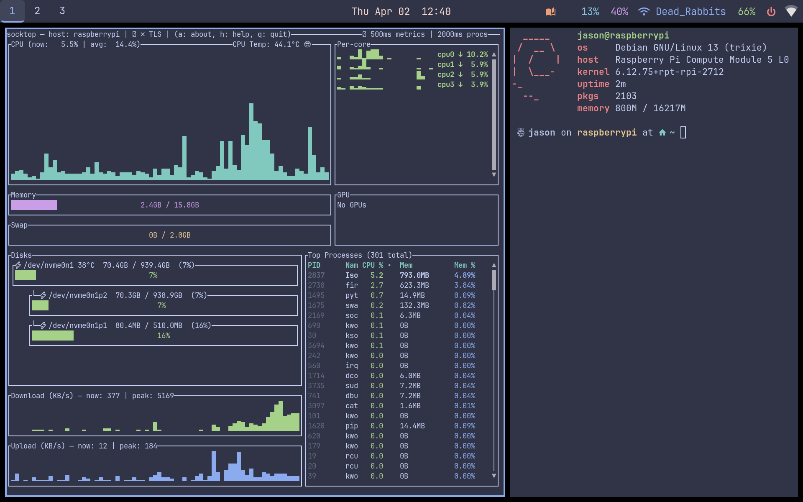

## Quick Install

Starting from a fresh [Raspberry Pi OS Lite](https://www.raspberrypi.com/software/) (Trixie, 64-bit) installation:

```bash
curl -fsSL https://raw.githubusercontent.com/jasonwitty/sway-argon-one-up/main/install.sh | bash
```

<!-- RC-ONLY: remove this block before merging to main -->
**Testing the 1.0 release candidate?** Install from this branch instead:

```bash
curl -fsSL https://raw.githubusercontent.com/jasonwitty/sway-argon-one-up/v.1.0_RC1/install.sh | REPO_BRANCH=v.1.0_RC1 bash
```
<!-- /RC-ONLY -->

See the [Installation Guide](Installation.md) for detailed step-by-step instructions including how to flash the NVMe drive and configure initial settings. To upgrade an existing install, run the same command again — see [Upgrading](Installation.md#upgrading).

## Hardware

This setup is built for the [Argon ONE UP CM5 Laptop](https://argon40.com/products/argon-one-up-cm5-laptop-core-system) which uses a Raspberry Pi Compute Module 5. The display is connected via HDMI internally, so standard backlight controls don't apply — brightness is controlled by writing DDC/CI commands directly to the display over I2C bus 14, achieving ~1ms response time. This approach was inspired by [esvertit's display calibration guide](https://forum.argon40.com/t/guide-professional-display-calibration-on-argon-one-up/9188) on the Argon40 forum. The Argon case also has its own battery, monitored by a purpose-built Rust binary ([argon-battery-rs](argon-battery-rs/)).

## What's Included

| Component | Description |
|-----------|-------------|
| `install.sh` | One-command installer for a fresh Raspberry Pi OS Lite; re-running it upgrades an existing install (configs are backed up first) |
| `sway/` | Sway config with themed window colors, idle lock, touchpad, media keys, panel and system-dashboard bindings |
| `waybar/` | Top bar with workspaces, clock (opens the calendar), CPU, volume, fan, Argon battery, network and Bluetooth (open their panels), idle/lock toggle, audio sink picker, tray, theme/scale/Claude/help/power buttons |
| `sway-themes/` | 12 theme definitions + templates for all themed apps (sway, waybar, foot, mako, swaylock, wofi, wob, the panels, Brave, Chromium, Thunar/GTK, system-dashboard) |
| `wallpapers/` | Matching wallpaper for each theme (auto-applied on theme switch); see `wallpapers/CREDITS.md` |
| `bin/` | User scripts: `switch-theme`, `sway-scale`, `sway-help`, `claude-prompt`, `brightness`, `start-wob`, `lid-suspend`, `soft-suspend`, `power-mode`, `power-startup`, `power-prompt`, `screen-record`, `idle-toggle`, `audio-sink-picker`, `bt-a2dp-guard`, `enable-widevine`, and the panel launchers and helpers (`panels`, `network-panel*`, `bluetooth-panel*`, `clock-panel`, `clock-label`) |
| `sbin/` | `set-cpu-governor`: small root helper the power scripts use through sudo to switch the CPU governor |
| `network-panel/` | Wi-Fi panel: network list with connect / forget / passphrase prompts, connection details, band pinning, DNS switch, captive-portal sign-in, Wi-Fi share QR code (`Mod+Ctrl+N`) |
| `bluetooth-panel/` | Bluetooth panel: pair, connect, forget, power (`Mod+Ctrl+B`) |
| `clock-panel/` | Calendar popup: month grid with week numbers and a year-progress rail (`Mod+Ctrl+C`) |
| `quickshell-panels/` | What the three panels share: the [Quickshell](https://quickshell.org) host process, UI kit and build script. The panels are ports of the [Omarchy](https://github.com/basecamp/omarchy) ones |
| `foot/` | Terminal emulator config with live-recolored theme support |
| `wofi/` | App launcher, help overlay and power menu styles |
| `wob/` | Wayland Overlay Bar config for brightness/volume indicators |
| `mako/` | Notification daemon themed to match |
| `swaylock/` | Lock screen with themed ring indicator |
| `gtk-3.0/` | GTK theme settings (switched automatically per theme) |
| `gtk-themes/` | 9 bundled GTK themes with upstream licenses |
| `fish/` | Fish shell config |
| `starship.toml` | Starship prompt config |
| `greetd/` | Login screen: greetd + gtkgreet with Catppuccin Frappe theme; survives booting with the lid closed |
| `wireplumber/` | WirePlumber policy: auto-route audio to Bluetooth devices on connect, prefer A2DP |
| `systemd/` | User units: `bt-a2dp-guard` (keeps Bluetooth headsets in A2DP stereo) and the idle-toggle watcher |
| `mpv/` | mpv config tuned for Pi 5 (hardware-friendly defaults) |
| `argon-battery-rs/` | Rust battery monitor; CW2217 fuel-gauge over I2C, auto brightness + governor switching on AC/battery transitions |
| `argon-fan/` | Rust PWM fan-control daemon with mode-based curves (silent / normal / turbo / full); waybar tile + wofi picker |
| `argon-lid-monitor/` | Rust GPIO 27 lid-event monitor; shells to `lid-suspend` to lock + sleep displays and switch governor on close |
| `power-button-guard/` | Rust daemon that turns a tap of the physical power button into the themed power menu (`power-prompt`) instead of an immediate power-off |
| `touchpad-native/` | libinput quirks + udev rule that make native disable-while-typing work on the AMIRA combo keyboard/touchpad; `touchpad-mode` turns it on/off (dashboard tile, `Mod+Shift+G`) |
| `trackpad-guard/` | Retired: the earlier Rust disable-while-typing daemon. No longer installed (the installer removes it on upgrade); the source is kept for building by hand |
| `system-dashboard/` | Tauri 2 desktop app bound to the hardware battery key (`Pause`): battery, power profile, idle mode, theme, fan, touchpad, brightness slider, volume slider — all live |
| `installer-test/` | Container smoke tests for the installer |

## Themes

Switch between 12 themes with **Mod+T** or the waybar palette icon. Every themed app updates simultaneously — sway window borders, waybar, foot terminals, mako notifications, swaylock, wofi, wob, the network / Bluetooth / calendar panels, GTK apps (including Thunar folder colors), Brave, Chromium, and the wallpaper.

<p>
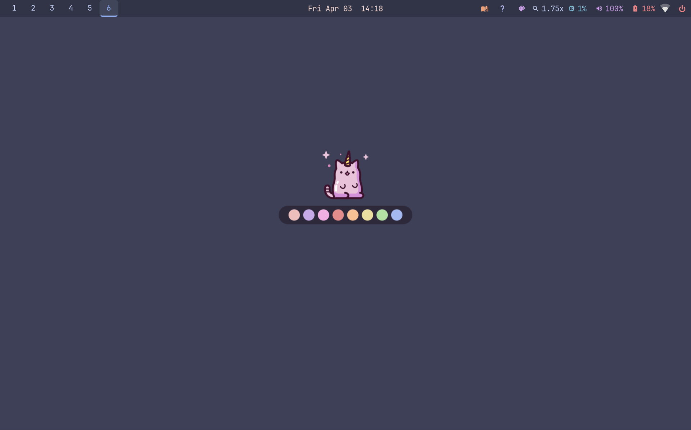
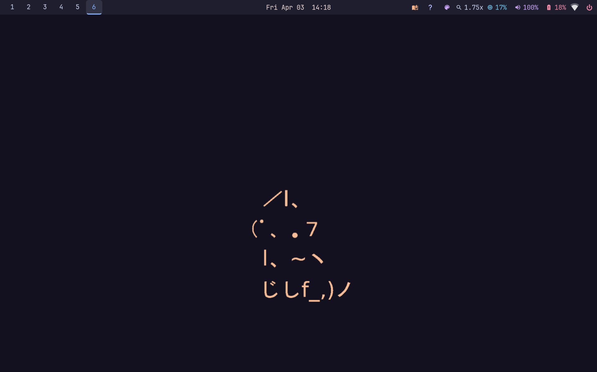
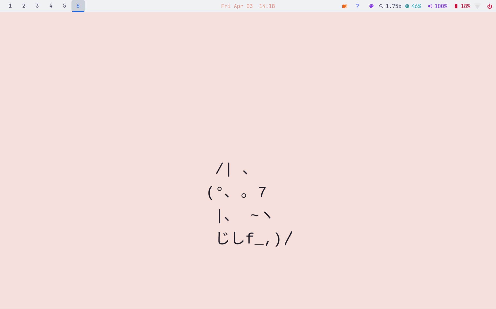
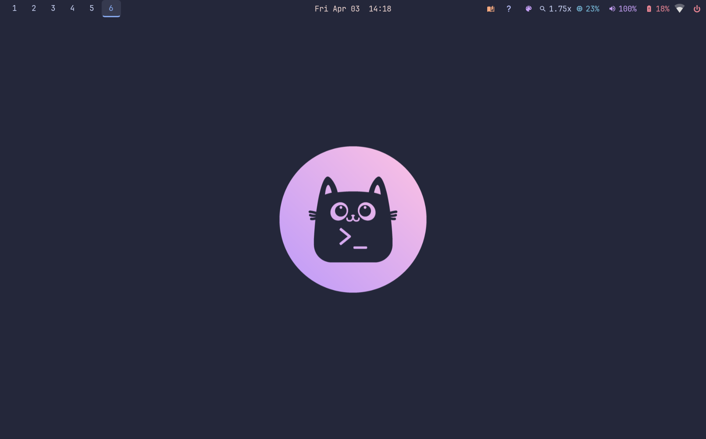
</p>
<p>
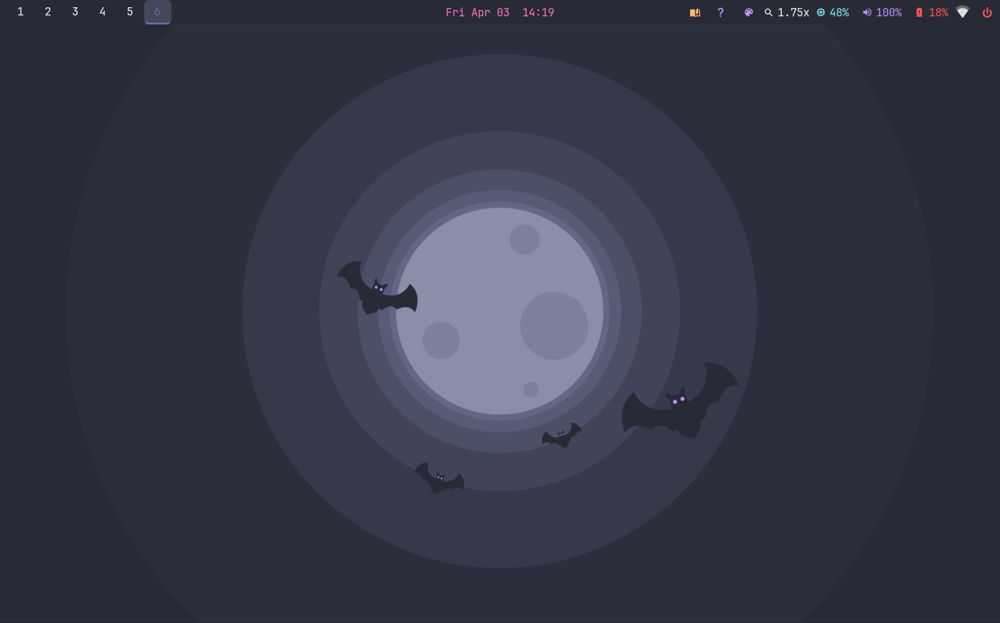
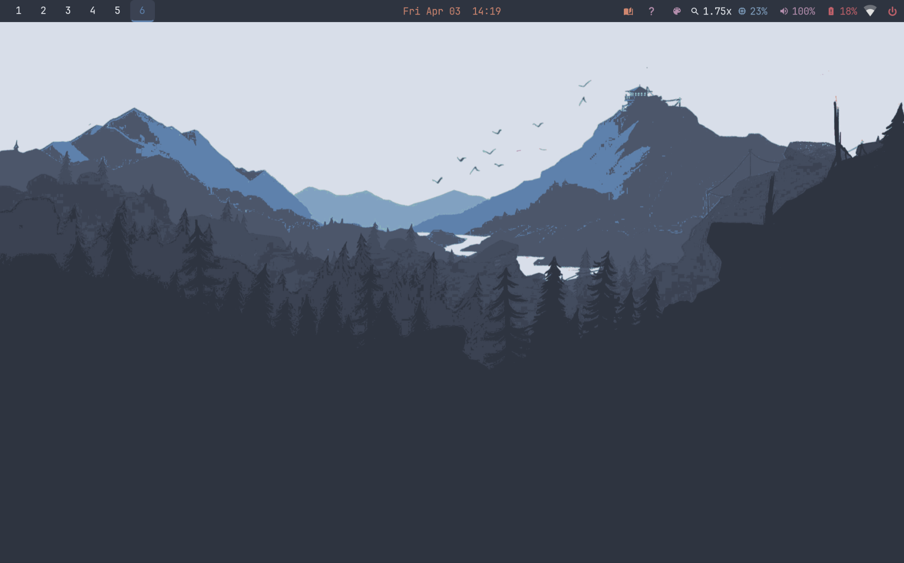
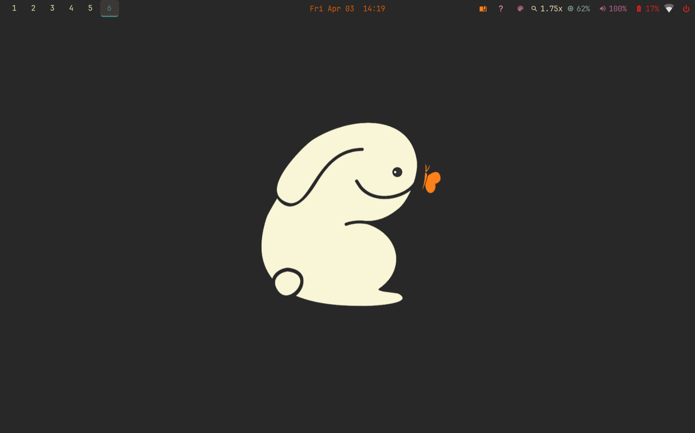
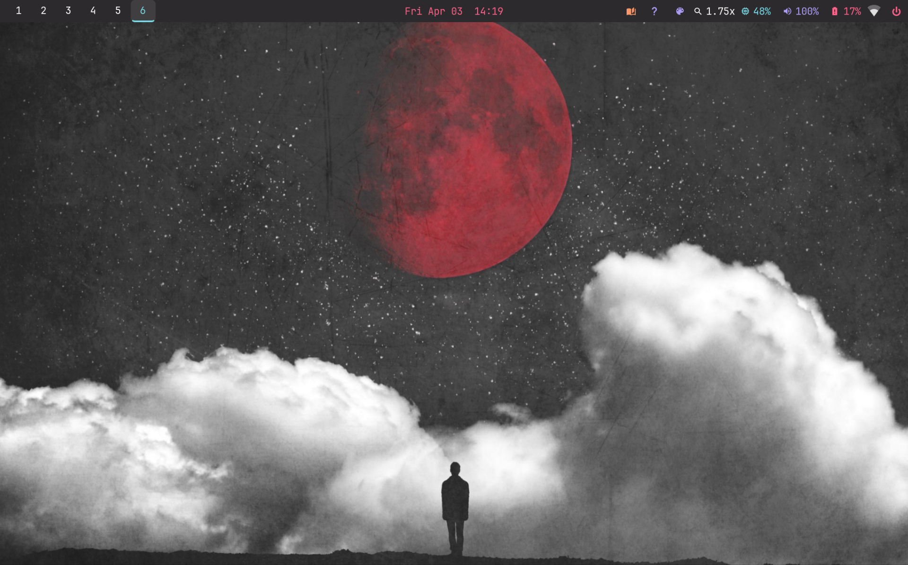
</p>
<p>
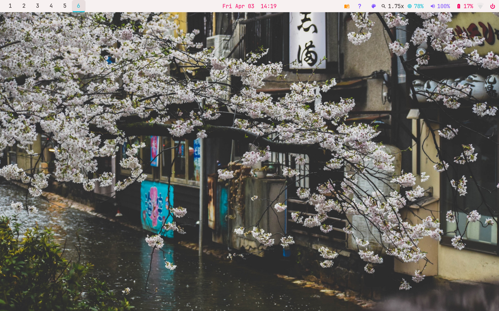
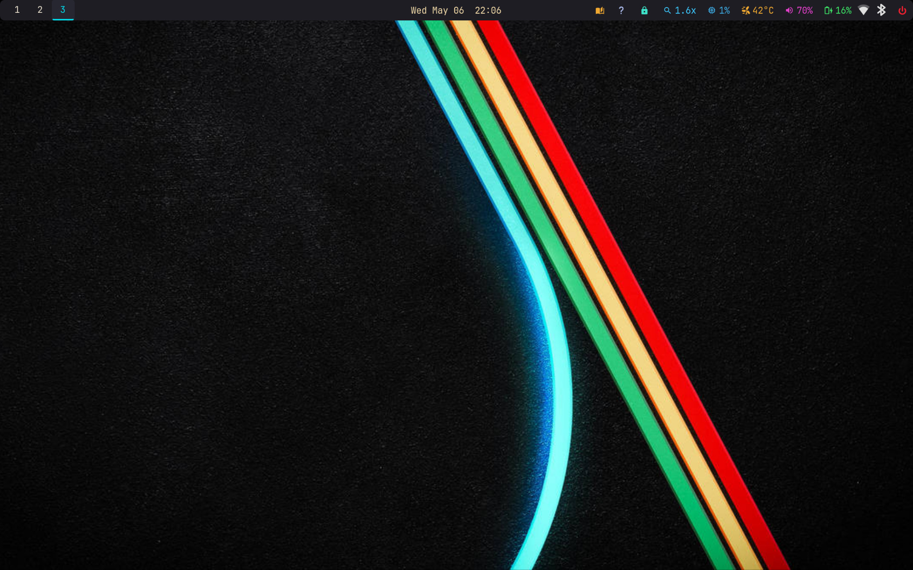
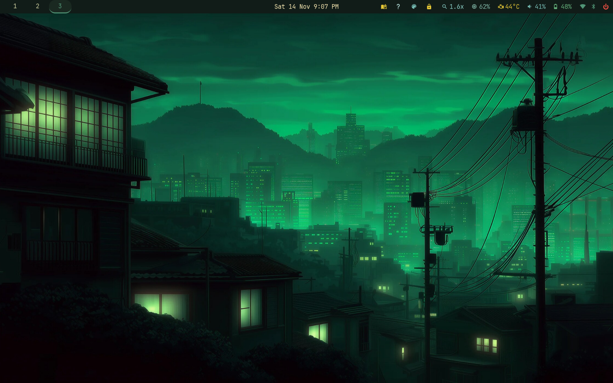
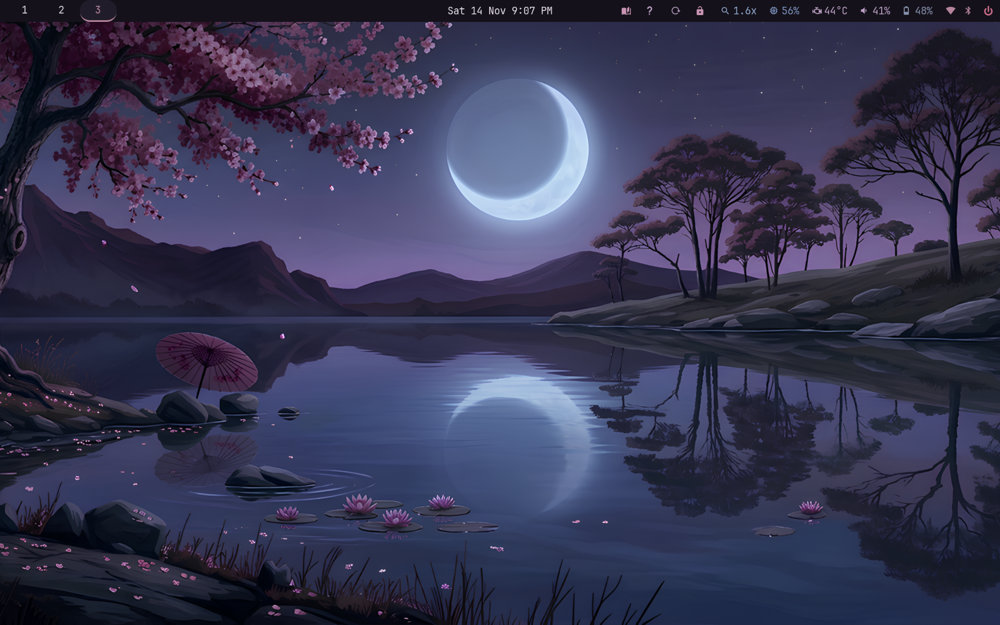
</p>

*Frappe, Mocha, Latte, Macchiato, Dracula, Nord, Gruvbox Dark, Monokai Dark, Monokai Light, Arc Raiders, Osaka Jade, Sakurazuki*

## Documentation

| Document | Description |
|----------|-------------|
| [Installation Guide](Installation.md) | Step-by-step setup from a blank NVMe drive to a working desktop |
| [Applications](Applications.md) | Complete list of installed software with descriptions |
| [Usage Manual](Usage_Manual.md) | Keyboard shortcuts, theme switching, power management, configuration reference |
| [Standalone Guides](Stand_Alone_Guides.md) | Self-contained guides for specific features you can add to your own setup |
| [Troubleshooting](Troubleshooting.md) | Common problems and solutions |

## License

[Apache License 2.0](LICENSE)

Bundled GTK themes retain their original licenses (GPL-3.0, MIT) — see individual theme directories under `gtk-themes/` for details.
